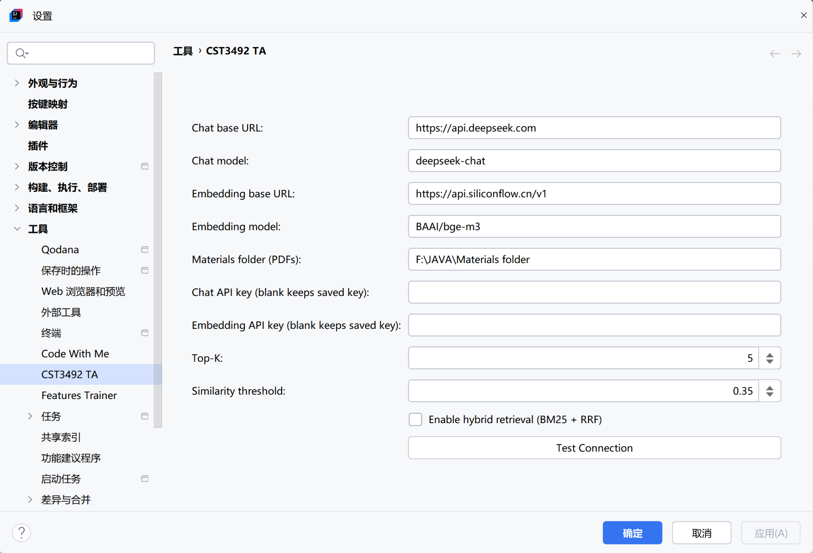
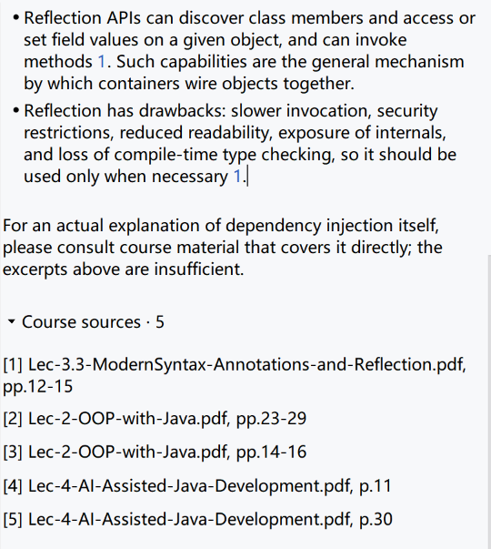
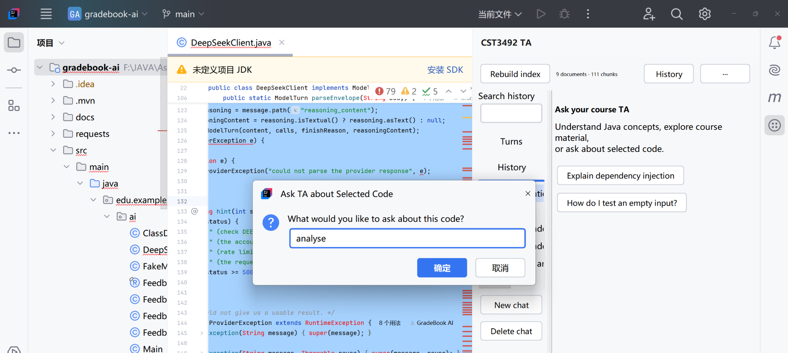
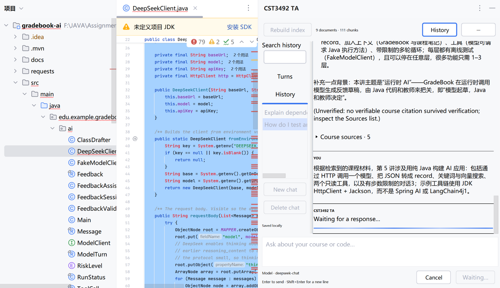
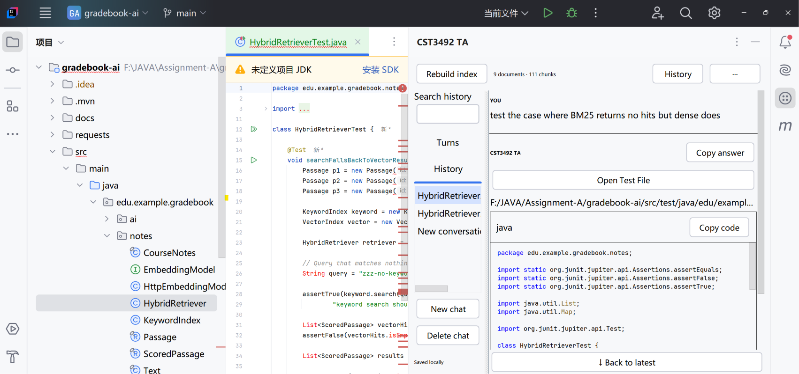
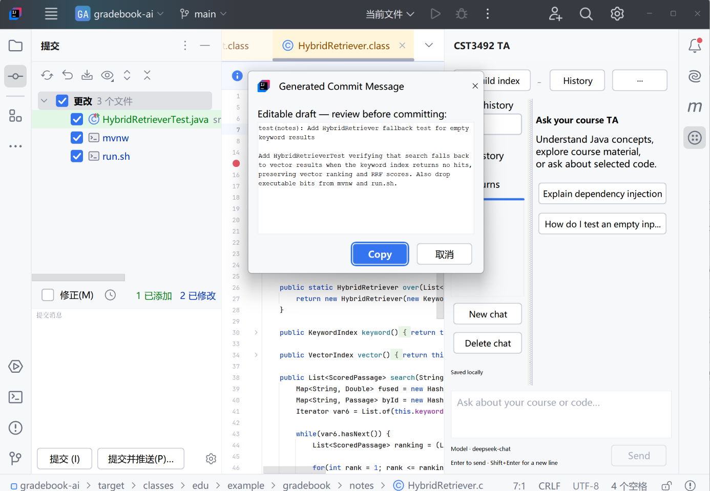
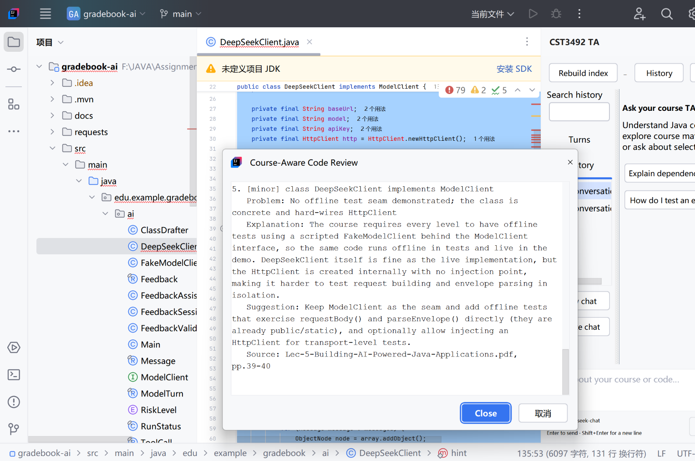
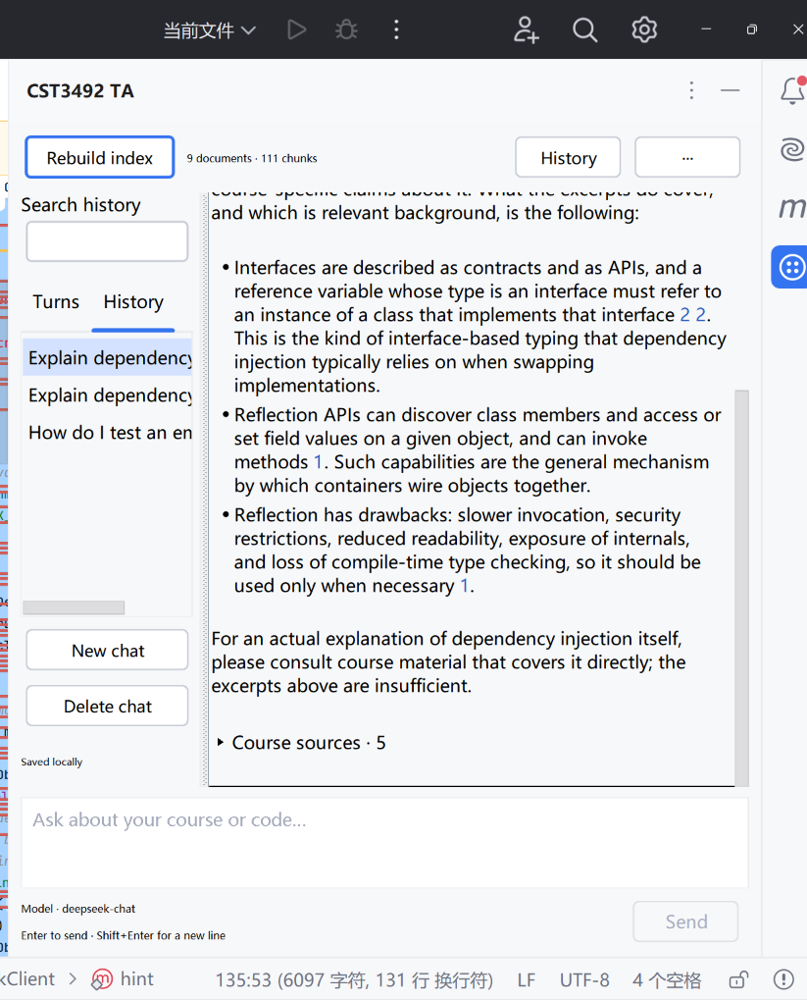

# 1. Team Particulars

CST3492 TA - Project Report

CST3492: Java Enterprise Application Development | Assignment A | AY 2026-2027, Semester 1 | Group B: F0 + F1

Report date: 3 November 2026. We reviewed the local integration of chat-ui-refresh PR #2 (31541df) together with our indexing, citation, cancellation and history improvements. Plugin descriptor version: 1.1.0.

## Team members

| Full name | Matriculation number | Email address | Contact number |
| --- | --- | --- | --- |
| Yuan Zihao | 2451769 | 2451769@tongji.edu.cn |  |
| Fu Yihao | 2452292 | 2452292@tongji.edu.cn |  |
| Yu Weiqiang | 2452688 | 2452688@tongji.edu.cn |  |
| Li Sihan | 2453202 | 2453202@tongji.edu.cn |  |

## Additional particulars

Repository: https://github.com/Fu-YH05/Java-Assignment-A

## Purpose and reading order

Our plugin helps students ask course-specific Java questions inside IntelliJ IDEA and automates routine testing, commit-message drafting and code review. We keep document and page provenance in the RAG pipeline so a student can open the lecture source instead of trusting a plausible answer.

We follow the required submission order: team particulars; implemented functionalities; user manual with UI samples; architecture, workflow, RAG structures, algorithms, LLM integration, design rationale and efficiency; and additional technical information. We separate what we have verified from what still needs manual acceptance.

# 2. Implemented Functionalities

| Requirement | Implemented behavior |
| --- | --- |
| F0: course RAG Q&A | We parse text PDFs page by page, chunk them and store embeddings. A query embedding retrieves the excerpts we send to the model. |
| F0: source citations | We check document/page tokens against the retrieved set, turn accepted ones into readable labels and number them as source links. |
| F0: general-knowledge disclosure | When retrieval returns nothing we show an explicit disclaimer. The prompt also asks the model to disclose when the excerpts are insufficient. |
| F0: embedded UI | We register an IDEA tool window that renders Markdown answers, code copying/highlighting, source disclosure, errors and cancellation. |
| F0: editor context | A right-click editor action sends the student question together with a snapshot of the selected code. |
| F1: scenario-based JUnit | We open a dedicated test chat that binds source, selection and package context, and it will not generate before the student writes a scenario. |
| F1: staged commit message | All staged textual changes go through a bounded diff/summarization pipeline that produces a Conventional Commit draft. |
| F1: creative action | Course-aware review returns problems, explanations, severity, suggestions and checked source references. |

## Additional features

We number questions in the Turns sidebar and jump to their cards. Conversations are saved per project, with new/open/delete, title and question search, draft restoration and source/code snapshots. If a request was interrupted we restore it without resending it automatically, and older transcripts still load with the local history schema.

The chat input box also accepts drag-and-drop from the file system: text files are appended with a separator, while PDFs and images show a dialog that points to the Materials folder or explains the OCR limitation. Dropping several files or an unsupported type is rejected with a message.

Test artifacts can be created or reopened from the chat. Our file service checks Java syntax and the bound package, resolves the source module and test root, warns when JUnit 5 is missing and refuses to overwrite an existing file. A missing test source root can be created and registered.

## Scope boundaries

This is our Group B implementation. Group C F2 code modification with a built-in side-by-side approval viewer is outside what we had to do. We do not implement OCR, DOCX/PPTX ingestion, token streaming or multi-turn model memory. Saved transcripts are for browsing; we do not put earlier turns back into later prompts.

### Changes from the design draft

The design draft (`docs/CST3492_GroupB_Design_and_Report_Draft.pdf`) was written before we started coding, so a few of its features changed or were dropped along the way. The table below lists what changed and why.

| Draft commitment | Final implementation | Why we changed it |
| --- | --- | --- |
| Streaming output; first token under 3 s (F0-3, §3.2, §4.4, §5.3.2, §5.6.1, §7.4) | A blocking `complete()` call with a progress bar and a Cancel button | Checking citations is easier on the whole answer, and our one retry also needs the full text (`TaProjectService.java` lines 283-297). Cancelling and timing out stay simple this way. |
| DOCX/PPTX materials (§5.3.1) | Text PDFs only | We only wired in PDFBox. DOCX/PPTX would need a layout engine to get reliable page numbers, and our citations are built on page numbers. |
| JGit `DiffCommand` (§5.3.1) | `git diff --cached` subprocess | Using the IDE's own git avoids classloader conflicts and shows the same staged files as IntelliJ. |
| LangChain4j adapter (§5.6.1) | `java.net.http.HttpClient` | The draft already allowed this fallback, and it keeps extra dependencies out of the platform classloader. |
| IntelliJ 2024.3, `sinceBuild 243` (§3.2) | 2024.2.6, `sinceBuild 242` | Everything we use works in 242, and 2024.2.6 is the Community edition we had and tested on. |
| 32 chunks per embedding request (§5.7) | 16 (`HttpEmbeddingProvider.BATCH_SIZE`) | The embedding provider rejected larger batches when we built the real index. |
| §7.4 targets: first token under 3 s, no-material accuracy 100 %, index under 60 s for 300 pages, memory under 300 MB | We do not stream, so the first-token target does not apply. Our unrelated cooking question still matched, and we report it as a miss in §5.1. Index time and memory were measured for parsing and chunking only (§4.11) | These targets were set before coding. We report what we actually measured, and the failed case is still in the table. |

# 3. User Manual

## 3.1 Installation and configuration

Use IntelliJ IDEA Community 2024.2.6 with Java 21 compatibility. Install the plugin ZIP through Settings > Plugins > Install Plugin from Disk, then restart if requested. To build from source, use JDK 21 or a compatible Gradle JVM and run gradlew.bat test buildPlugin from cst3492-ta-plugin. Our normal development launcher is gradlew.bat runIde.

Open Settings > Tools > CST3492 TA. Here you configure the chat endpoint/model and Chat API key, the separate embedding endpoint/model and Embedding API key, and a local folder of text PDFs. We default to DeepSeek chat (https://api.deepseek.com; deepseek-chat) and SiliconFlow embeddings (https://api.siliconflow.cn/v1; BAAI/bge-m3), so each key must belong to its own provider. Leaving a key field blank keeps the saved key. After Apply, Test Connection sends real requests to both services.

Open CST3492 TA and click **Build index**. Each build rescans the Materials folder, so any PDF added since the last build is parsed, chunked and embedded automatically; unchanged documents are skipped by SHA-256 hash. Rebuild after changing materials, the embedding provider/model or the chunking format.

The chat input box also accepts drag-and-drop: text files (.txt, .md, source code, …) are appended with a separator; PDFs and images show a dialog pointing to the Materials folder or explaining the OCR limitation; unsupported types are rejected with a message.

Ask a question, read the answer and expand **Course sources**. Click a numbered reference to jump to its source row. Enter sends; Shift+Enter inserts a newline. Copy code copies only the code; Copy answer keeps the answer and its references.

## 3.2 Selected-code questions and history

Select a Java code segment, right-click Ask TA about Selected Code, and enter a question. We open the TA window with the selection snapshot attached, so check the selected-code indicator before asking anything else. If the request fails, the question and context stay available for a retry, and an unrelated draft is kept.

Use History to show or hide the sidebar. Turns lists the numbered questions and their request state, and selecting one scrolls to its card. History lists saved conversations, and Search history matches titles and questions. New chat starts a separate transcript; Delete chat asks for confirmation. We block session switching and deletion while a request or build is running. Clear conversation removes the current turns but keeps the draft, and reopening the project restores its last conversation.

## 3.3 Generate JUnit tests from a requirement

In a Java file, select the target method or class and invoke Generate Tests from Requirement. We capture the containing source, the selection, the package and the source path, then open a dedicated test conversation that shows the bound snapshot. Type a specific scenario, for example: test the case where the input is an empty string. Nothing is sent to the model before you submit the scenario.

Review the generated Java artifact in the chat. Create Test File checks syntax and package and resolves the bound module. Choose a test root when several exist, and confirm the JUnit warning if the dependency is missing. We refuse to overwrite existing files. After creation, Open Test File reopens the result. Add the required dependencies and run the test yourself; a syntax check does not prove that the assertions or the behaviour are right.

## 3.4 Draft a commit message and review code

Stage changes in Git, then use VCS > Generate Commit Message from Staged Changes. Review the proposed type, scope, subject and body. We do not stage files or commit for you. With large diffs, several summarization requests may run before the final draft appears, and an empty staging area is reported separately from a Git or provider failure.

Select code and invoke Review Code with Course Context. Read the severity, approximate location, problem, explanation and suggestion. We check every reported source against the retrieved excerpts: an unknown reference is removed, and when no course sources were retrieved we show a general-knowledge notice. This action only gives advice; it never edits production code.

## 3.5 Cancel and troubleshoot

Use Cancel in chat or the IDE task cancellation control. Cancelling interrupts the network worker and suppresses late result dialogs, but it cannot undo a provider request that was already received or billed. For HTTP 401 check the relevant provider key; for an empty index build the index first; for changed embedding settings rebuild. If history cannot be read we still allow a temporary chat without overwriting the unreadable file.

# 4. Architecture, RAG and LLM Integration

## 4.1 Architecture overview

We separate the Swing view, the IDE adapter, the project orchestration and the data/HTTP services. That keeps slow parsing and network work off the event dispatch thread, and it lets us test most logic and the real conversation component offline.

| Layer / component | Responsibility |
| --- | --- |
| ChatView / ChatPanel | We render turns, history, sources and artifacts, and adapt UI callbacks to cancellable project tasks. |
| TaProjectService | We load and activate the index, build incremental snapshots, check embedding compatibility, retrieve context and call the LLM. |
| MaterialParser / Chunker | We extract text with page identity and form overlapping, provenance-aware retrieval units. |
| JsonVectorStore / IndexMeta | We persist document hashes, chunk metadata and row-aligned float vectors. |
| Retriever / KeywordIndex / HybridRetriever | We rank by dense cosine top-K, BM25 exact-term matching and optional rank fusion. |
| PromptBuilder / CitationVerifier | We build the contextual instructions, check citation membership and ranges, and supply fallback notices. |
| HttpLlmClient / HttpEmbeddingProvider | We talk to each provider through compatible JSON HTTP requests. |
| BackgroundWork / TaskAwaiter | We watch for cancellation or project disposal and interrupt the worker. |
| ChatHistoryStore / TestFileService | We keep local transcript snapshots, and validate and create test files only when the user asks. |

## 4.2 Index-building lane

Materials folder -> PDF pages -> page-aware chunks -> embedding batches -> normalized vectors -> candidate snapshot -> save -> activate retrievers. We hash each file, so unchanged documents reuse their chunks and vectors when the provider, model and chunking version still match. If an embedding stage fails, the previous active snapshot stays usable.

## 4.3 Answering lane

Question + optional selected code -> query embedding -> compatible-index check -> dense or hybrid search -> context budget -> grounded/general prompt -> chat completion -> at most one retry for empty or uncited output -> citation verification -> UI rendering and history save. If the answer is still empty after the retry, we surface it as an explicit request error.

## 4.4 IDE execution model

We keep UI interactions and file dialogs on the EDT; network, Git, indexing and history writes run in the background. Project service synchronization serializes retrieval and build operations. TestFileService uses read actions for PSI and module resolution, and an undoable write command to create the file. Save callbacks capture detached history snapshots and run in order.

## 4.5 Page-aware chunking and provenance

We extract each PDF page separately with PDFBox. KnowledgeChunk stores id, docId, docName, pageFrom, pageTo, title, text, tokenCount and a text hash. Chunker uses a 400-word window with 60-word overlap. Pages shorter than 60 words accumulate with the following content, and any short content left at the end is still emitted. Per-word page numbers give the real page range of every window. Window sizes are word-based, so tokenCount is an estimate rather than a provider tokenizer measurement.

## 4.6 Persistence and index compatibility

index.meta.json holds document SHA-256 hashes, page and chunk information, chunk records, the embedding model and base URL, the dimension and the chunking version. vectors.bin stores the matching rows as little-endian float32, and the row order must match the chunk list, which we check by file length on load. Candidate snapshots protect the active retriever from a failed rebuild, and we replace temporary files one by one. This two-file publication is not a transaction across both files, so a crash between the two replacements remains a persistence limitation.

## 4.7 Dense, keyword and hybrid retrieval

We combine the document name, starting page, title and chunk text as the embedding input. Requests go out in batches of 16. Query and stored vectors are normalized; dense retrieval ranks by cosine similarity and filters with the configured threshold. Defaults are top-K = 5, threshold = 0.35 and a context budget of 4,000 estimated tokens, and we keep adding chunks until the next one would exceed the budget.

BM25 complements dense retrieval for exact identifiers. Its parameters are k1 = 1.5 and b = 0.75, using term/document frequency and document-length normalization. Hybrid retrieval takes up to ten hits per branch, fuses them with RRF(d) = sum(1 / (60 + rank(d))) and keeps top-K. Rank fusion avoids adding cosine and BM25 scores that use different scales. Hybrid mode is off by default.

## 4.8 Citation verification and fallback

The model emits {{cite:docId#page}}. We split the page number at the final hash, which allows hashes inside document names. Verification accepts only documents retrieved for this request and pages inside their chunk ranges, then shows the document name with the page or page range. Unknown, malformed, overflowing and unterminated tokens are removed. Continuous spaces are preserved so code indentation survives.

Empty retrieval enforces the explicit general-knowledge disclaimer. With nonempty retrieval, an answer that keeps no citation triggers one controlled regeneration, and a second uncited response is marked Unverified. This verifies provenance membership, not semantic support. BM25 can match irrelevant ordinary words, so returning hits does not guarantee that the question really has an answer in the materials.

## 4.9 HTTP integration and prompt engineering

JDK HttpClient sends JSON chat messages to /chat/completions and embedding inputs to /embeddings. Chat and embedding endpoints, models and secrets stay separate. Chat requests are non-streaming, with a configurable timeout (default 60 seconds). Ordinary Q&A uses temperature 0.2 and a 1,200-token completion limit; test generation uses temperature 0.1 and up to 4,000 output tokens. Where the provider reports it, we distinguish authentication, balance, rate-limit and server errors.

The grounded system prompt identifies the course TA, asks for the language of the student question, limits course-specific claims to the supplied excerpts and requires citation tokens. The user prompt carries the original question, optional code and numbered source excerpts. General mode forbids invented references. Retry instructions ask for a nonempty answer or valid citations without creating an endless retry loop.

The test-generation prompt binds the source package, the selected target and the full source snapshot to the natural-language scenario, and asks for one complete JUnit 5 class without invented dependencies. GeneratedTestCode rejects ambiguous multiple or non-Java fenced artifacts, and TestFileService checks syntax and the required package before allowing file creation. We treat source input as data rather than instructions, which reduces but does not remove prompt-injection risk.

## 4.10 Commit drafting and creative review

We read staged changes with git diff --cached, with external diff and textconv helpers disabled and a 30-second deadline. A small diff goes straight to the model. Large diffs are split at file boundaries into bounded pieces, every input piece goes into a summary, and groups of three are reduced until the final context fits 6,000 characters. That avoids silent truncation, but semantic omissions can still happen during model summarization. The output is a Conventional Commit JSON draft.

Course-aware review combines the selected code with retrieved excerpts. JSON findings carry location, severity, problem, explanation, suggestion and citation, and we resolve the source field through the same document/page whitelist before display. The student still decides whether to apply the advice.

## 4.11 Efficiency and dependency choices

Dense scanning costs O(ND) for N chunks of D dimensions and needs roughly 4ND bytes for raw vectors, excluding metadata and runtime objects. At our recorded 111 chunks and 1,024 dimensions that is 454,656 bytes. Incremental hashing and batched embeddings cut repeated provider calls. Local JSON/binary storage is easy to inspect, but we target a small course corpus rather than a large concurrent service.

We measured on this machine with the target JBR 21.0.5 (project compatibility level Java 21, `-Xmx512m`, cold JVM, single run) against the configured Materials folder: 9 PDFs, 199 pages and 82,606 characters parse in 1,121 ms and chunk in 53 ms, producing 111 chunks. Heap returns to 13.1 MB after garbage collection, while the sampled peak during parsing reaches 126.3 MB, caused by transient PDFBox page objects rather than by retained chunk text. These figures cover parsing and chunking only; embedding latency depends on the provider and network, so we do not quote it as a fixed budget. We rebuild the index only when a document hash, the chunking format or the embedding configuration changes, so this cost is not paid on every question.

PDFBox preserves page provenance, CommonMark parses Markdown, RSyntaxTextArea gives copyable code highlighting and Jackson handles JSON. LangChain4j and Apache Tika are assignment references rather than required dependencies. Direct HTTP and PDF parsing keep the implementation inspectable. Cancellation, retry and map/reduce add reliability at the cost of code complexity, latency and potentially more provider charges.

# 5. Additional Technical Information

## 5.1 Verification and evidence

Our local implementation passed a full Gradle test/chatUiTest/buildPlugin cycle with 71 JUnit tests and 33 overlapping UI checks. After the PR #2 adaptation we compiled source and tests with Java 21 compatibility, and 73 JUnit tests passed with no failures or skips on the target JBR. The two runs were separate, so these numbers should not be added together. We assembled the PR #2 runtime package from current production classes plus the previously built plugin resources and libraries; we do not claim a fresh full Gradle build for that final integration.

Our tests cover chunk text and page ranges, the index lifecycle, vector persistence, ranking, citation rejection and indentation, diff partitioning, worker interruption, Markdown safety, history persistence and restoration, turn navigation, artifact extraction and scenario-first test conversations. We also saw the D-drive IDEA runtime respond with CST3492 TA loaded. These checks do not establish real-provider quality, nor successful interactive PSI file creation in every module layout.

| Recorded retrieval experiment | Result |
| --- | --- |
| Corpus / development labels | 9 PDFs; 111 chunks; 9 positive questions; 1 unrelated question |
| BM25 Hit@5 / MRR@5 | 1.0000 / 0.9444 |
| Mean seed-page Recall@5 | 1.0000 |
| BM25 negative no-hit rate | 0.0000: unrelated cooking question still matched |
| Stored-vector self-retrieval | 111 / 111; persistence/cosine sanity check only |

The benchmark uses small manually seeded page labels, not an independent exhaustive relevance set. It excludes live query embeddings, HTTP/LLM latency and answer entailment. We keep the negative failure in this table: neither the positive scores nor self-retrieval show that out-of-domain questions behave reliably.

## 5.2 Storage, security and privacy

We keep non-secret settings in the IDEA persistent state component and keys in PasswordSafe. Saved-key lookup and model calls stay off the EDT. Rendered raw HTML is escaped, unsafe URLs are sanitized and image nodes are removed recursively, so model images cannot trigger hidden fetches. We never run generated tests automatically.

History stores questions, submitted code, answers, source labels, drafts and test-artifact metadata as local plaintext JSON in the IDE system directory, partitioned by project. It excludes credentials, vectors and retrieved PDF text. Atomic file replacement and detached snapshots protect normal saves, and unreadable files are preserved and reported. Our configured D-drive runtime keeps system/config/plugins/log/temp data under D:/CST3492-TA-runtime. Course indexes live in the runtime APPDATA/cst3492-ta/index folder.

## 5.3 Remaining limitations and acceptance

Before submission we still need to demonstrate a real course question with manually checked source pages; an unrelated question and its disclosure; a selected-code question; scenario-based test generation followed by creation and execution; multiple staged files including a large late diff; and course-aware review with invalid-reference rejection. We also check theme changes, source navigation, history reload and cancellation. A valid citation does not guarantee a correct interpretation, and a generated test may compile but assert the wrong behaviour.

Known limits are text PDFs only, small-corpus linear search, no multi-turn model context, optional hybrid false positives and a two-file index publication window. Test-root registration in IDEA does not automatically edit Maven/Gradle dependencies. Cancellation cannot revoke a provider request that has already been received. Large diffs need extra calls. Future work would mainly be held-out multilingual and negative retrieval tests, live answer-quality and latency checks, and more robust persistence.

## 5.4 Collaboration and reproducibility

Our repository uses a short-branch workflow: agree on ownership, run the checks, request review and merge reviewed changes. PR #2 supplied source-bound test chat and file-creation improvements, while our local integration kept the citation/index fixes, cancellation and the existing history schema.

| Member | Responsibility |
| --- | --- |
| Fu Yihao | Built the baseline plugin skeleton (module layout, settings panel and chat wiring) and fixed defects raised during integration. |
| Li Sihan | Refined the chat interface and implemented conversation-history access, including session selection, search and turn navigation. |
| Yu Weiqiang | Identified and fixed defects through manual acceptance runs, and prepared and delivered the project demonstration. |
| Yuan Zihao | Completed the overall test coverage and hardening pass, and wrote the project report and presentation slides. |

Review evidence: every change was checked by a second member before merging, and we resolved conflicts by keeping the behaviour verified in the acceptance flow (building the index, asking a question, cancel and history restore) rather than by preferring one branch wholesale.

## 5.5 Submission checklist

The brief (page 3) requires three materials: (a) the complete source code; (b) one project report in English and PDF that covers the five required parts in the given order; and (c) presentation slides in English and PDF whose first slide lists every member's full name and matriculation number. Source code and documents must sit in separate folders inside one ZIP submitted through Canvas.

| Item | Requirement | Location in this submission | Status |
| --- | --- | --- | --- |
| (a) Source code | Complete and buildable | `cst3492-ta-plugin/` with `build.gradle`, the Gradle wrapper and `src/` | Ready; run a fresh `gradlew build` before packaging |
| (b) Project report | English PDF, five parts in order | This document: §1 particulars, §2 functionalities, §3 user manual with UI samples, §4 architecture/RAG/LLM, §5 additional technical information | Sections complete with team particulars filled; ready for PDF export |
| (c) Presentation slides | English PDF, first slide lists names and matriculation numbers | `output/pdf/CST3492_GroupB_Demo_Slides.pdf` | Slide 1 already lists the four full names and matriculation numbers recorded in §1 |
| Packaging | Source and documents in separate folders, compressed into one ZIP | Split into a source folder and a documents folder | Pending the final build |

The submission ZIP must exclude API keys and other local secrets, course PDFs that cannot be redistributed, Gradle caches, `build/` output and runtime conversation history. The installable plugin archive (`cst3492-ta-plugin/build/distributions/cst3492-ta-1.1.0.zip`) is a separate deliverable, not the assignment submission ZIP.

## 5.6 Source materials and references

[1] AY202627S1-CST3492-Assignment-A.pdf, supplied assignment brief, especially Submission (page 3) and F0/F1 (pages 1-2).

[2] Local source tree: cst3492-ta-plugin/src/main; tests in src/test; verification/evaluation-results.json and evaluation/queries.tsv; PR2_INTEGRATION.md and recorded test logs. Repository: https://github.com/Fu-YH05/Java-Assignment-A

[3] Assignment-provided development references: https://plugins.jetbrains.com/docs/intellij/developing-plugins.html ; https://platform.deepseek.com ; https://github.com/langchain4j/langchain4j ; https://tika.apache.org ; https://aws.amazon.com/what-is/retrieval-augmented-generation . These are reference links, not a claim of newly verified online content.
